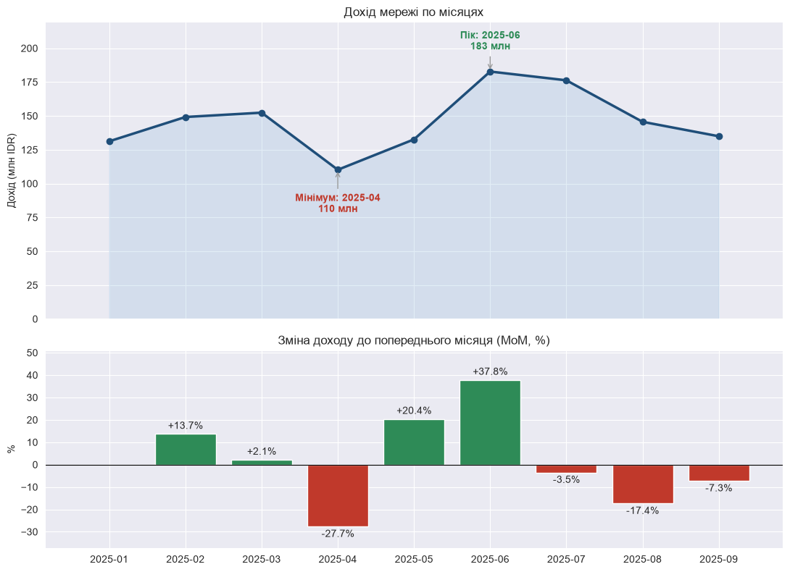
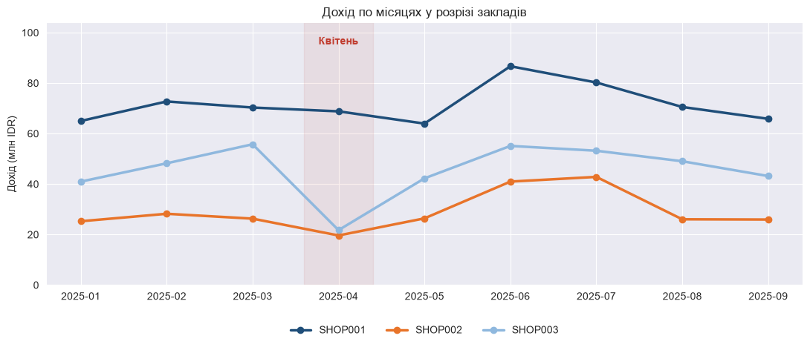
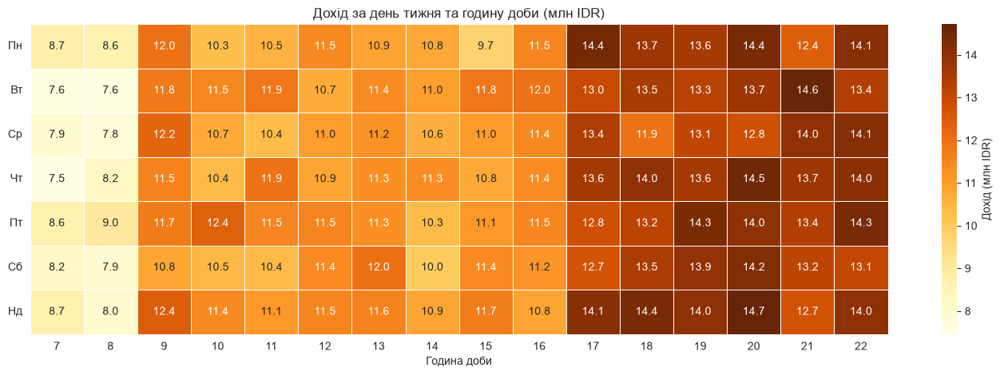
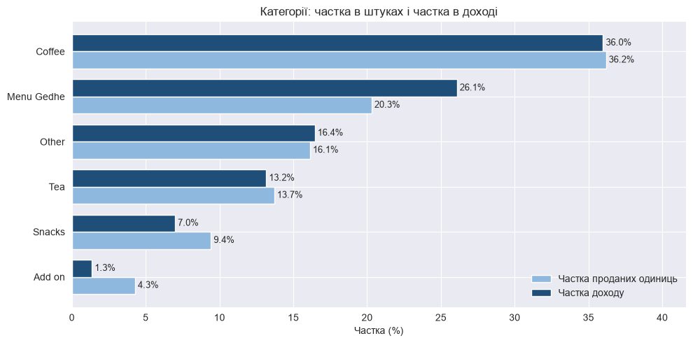
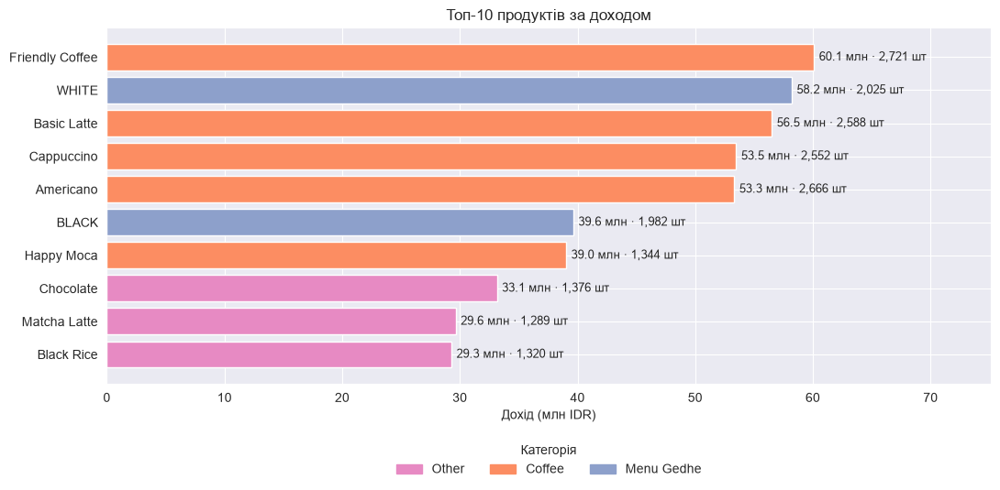
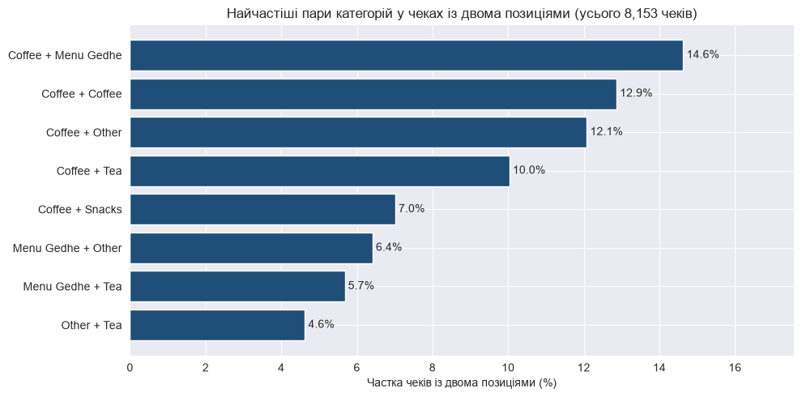

# F&B Sales Analytics: аналіз продажів мережі кав'ярень

Аналіз 53 820 чеків із касової системи (POS) трьох кав'ярень в Індонезії за січень–вересень 2025: де, коли і на чому бізнес заробляє, що сталося з продажами в квітні та які ідеї варто перевірити для зростання.

**Інструменти:** Python · pandas · numpy · matplotlib · seaborn · Jupyter Notebook

---

## Ключові висновки

| Тема | Що показують дані |
|---|---|
| Масштаб | 53 820 чеків, 61 973 проданих позицій, **≈1,32 млрд IDR** (2 січня – 30 вересня 2025). Середній оплачений чек ≈ 25,3 тис. IDR, медіана 23 тис. |
| Заклади | `SHOP001` дає **49%** доходу (644 млн), `SHOP003` 31% (410 млн), `SHOP002` 20% (262 млн). Середній чек майже однаковий (25,1–25,3 тис. IDR), тож різниця в **кількості гостей**, а не в чеку |
| Сезонність | Пік у червні (**183 млн IDR, +37,8%** до травня), провал у квітні (**110 млн, −27,7%** до березня), далі спад: липень −3,5%, серпень −17,4%, вересень −7,3% |
| Квітень | Дохід на день просів у `SHOP003` на 60% (≈1,80 → 0,72 млн IDR), у `SHOP002` на 23%, у `SHOP001` не змінився. Усі заклади продавали **кожного дня квітня**, а середній чек лишився стабільним, отже впала кількість чеків, а не працювали менше |
| Час | Найсильніші години **17:00–22:00** (≈7,1–7,5% доходу на годину), найслабші **7–8 ранку** (≈4,3–4,4%). День тижня майже не впливає |
| Категорії | Coffee ≈36% і штук, і доходу. **Menu Gedhe**: 20,3% штук, але 26,1% доходу. **Snacks**: 9,4% штук, але лише 7,0% доходу. Add on ≈1,3% |
| Продукти | Топ-10 продуктів дають **34,4%** доходу (з 68 продуктів). Лідери: Friendly Coffee, WHITE, Basic Latte |
| Лояльність | 1 733 чеки (3,2%), безкоштовні позиції на **44,3 млн IDR** (3,3% вартості проданого). Найчастіше безкоштовними стають Menu Gedhe (3,9%), Other (3,7%), Coffee (3,3%); чай лише 0,7% |
| Оплата | BCA: 79,5% чеків і 82,2% доходу; готівка 20,3% і 17,6%; GoFood лише 0,2% (102 чеки). Середній оплачений чек не залежить від способу оплати (25,3 проти 25,2 тис. IDR) |
| Кошик | **84,9%** чеків містять одну позицію, 15,1% дві (у середньому 1,15). Кава є у 59% чеків із двома позиціями, найчастіша пара Coffee + Menu Gedhe (14,6%) |

---

## Графіки

### Дохід по місяцях: пік у червні, провал у квітні


### Квітень по закладах: просіли `SHOP003` і `SHOP002`, `SHOP001` стабільний


### Коли купують: вечір сильний, ранок слабкий, дні тижня схожі


### Категорії: Menu Gedhe заробляє більше, ніж продається


### Топ-10 продуктів за доходом


### Що купують разом


Усі графіки, таблиці та розрахунки є в ноутбуці.

---

## Що зроблено

1. **Перевірка даних:** пропуски, дублікати чеків, від'ємні й нульові суми, періоди.
2. **Звірка сум:** дохід, порахований по окремих товарах, збігається з сумою чеків до однієї рупії (1 315 276 000 IDR).
3. **Підготовка:** розбиття списку товарів у чеку на окремі позиції (`explode`), приєднання довідника меню.
4. **Аналіз:** KPI, порівняння закладів, динаміка по місяцях (MoM), розбір квітневого провалу, теплова карта «день × година», категорії та продукти, програма лояльності, способи оплати, аналіз кошика.
5. **Висновки й гіпотези** для бізнесу.

---

## Ідеї для бізнесу (гіпотези, які варто перевірити)

1. **Збільшити частку чеків із двома позиціями.** Лише 15% чеків містять другу позицію. Перевірити можна комбо «кава + випічка».
2. **Підсилити ранок (7–8 годин)**, найслабші години в усіх закладах. Варіант: сніданкова пропозиція.
3. **З'ясувати причину квітня в `SHOP002` і `SHOP003`.** Заклади працювали, але чеків стало суттєво менше (ремонт поруч, свята, конкуренти, акції).
4. **Переглянути програму лояльності для чаю й добавок:** використання майже нульове.
5. **Для `SHOP002` і `SHOP003` працювати з потоком гостей**, бо середній чек уже такий самий, як у лідера.

---

## Обмеження

- У даних немає собівартості, тому аналізується **дохід, а не прибуток**.
- Немає ідентифікатора клієнта, тому не можна порахувати повторні візити та утримання.
- Лише 9 місяців: річну сезонність оцінити неможливо.
- Причину квітневого провалу дані не пояснюють, вони лише показують, де і наскільки він стався.
- Чеки за карткою лояльності мають нульову суму, тому середній чек рахується лише за оплаченими чеками.

---

## Дані

| Файл | Опис |
|---|---|
| `Transactions.csv` | 53 820 чеків: заклад, дата, час, суми, список товарів, кількість позицій, спосіб оплати, ознака лояльності |
| `Products.csv` | довідник меню: 96 позицій (68 унікальних назв), категорія, варіант, ціна |

Валюта: індонезійська рупія (IDR).

---

## Структура репозиторію

```
├── data/
│   ├── Products.csv
│   └── Transactions.csv
├── notebook/
│   └── fnb_sales_analysis.ipynb
├── images/                  # графіки для README
└── README.md
```

## Як запустити

```bash
pip install pandas numpy matplotlib seaborn jupyter
jupyter notebook notebook/fnb_sales_analysis.ipynb
```

Ноутбук сам шукає файли в `../data/`, `data/` або поруч із собою. Далі: **Run All**.

---

## Автор

**Dmytro Chuchman**, студент Computer Mathematics (КНУ імені Тараса Шевченка), шукаю роль Junior/Intern Data Analyst.
Email: dmytrochuchman2024@gmail.com
